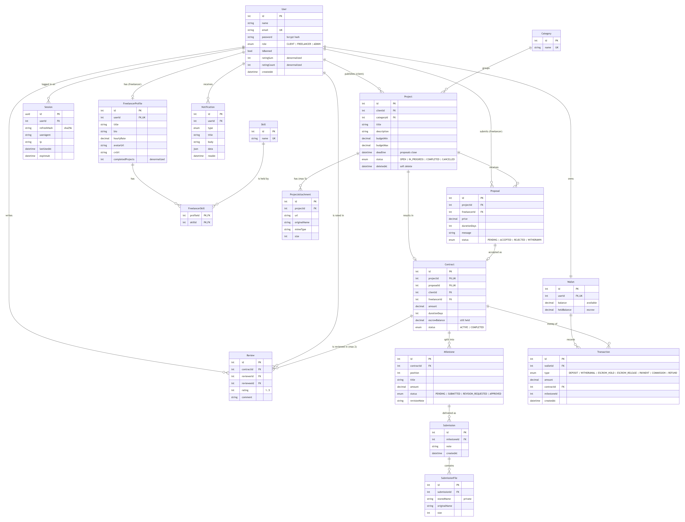

# FreelanceHub — Back-End (v2)

**English** · [العربية](README.ar.md)

Back-end for an Arabic freelance marketplace that connects clients with freelancers, with an **escrow wallet** and **contracts paid milestone by milestone**.

**NestJS 11 · TypeScript · PostgreSQL 16 · Prisma 6 · Redis · BullMQ · JWT · Docker**

| File | Contents |
|---|---|
| [`postman/FreelanceHub.postman_collection.json`](postman/FreelanceHub.postman_collection.json) | **Postman collection**: 107 requests with real example responses and 152 automated checks. Import it, then Run |
| [`assets/erd.png`](assets/erd.png) | Database diagram (ERD) |

---

## Highlights

- **Escrow wallet**: accepting a proposal holds the client's funds; each approved milestone releases its amount, split **90% freelancer / 10% platform** down to the last cent. The last milestone completes the contract and refunds whatever is left.
- **One transaction per money move**: accepting a proposal holds funds, creates the contract and rejects the other proposals atomically, and stays correct when two requests arrive at the same moment.
- **Sessions per device**: JWT access/refresh tokens with rotation. Reusing an old refresh token ends **every** session. Users can list their devices and sign out of one.
- **Roles**: Client, Freelancer and Admin, with an admin dashboard, user search and instant bans.
- **Rate limits**: login 5/minute, registration 3/hour/IP, proposals 20/day.
- **Redis caching** with invalidation on change, a **BullMQ** email queue, and a **midnight job** that expires stale projects.
- **File uploads** with type and size limits; contract deliverables are private to the two parties and admins.
- **Tests**: unit tests plus **36 end-to-end tests** on real PostgreSQL and Redis.

## Database



---

## Quick start (Windows)

Requirements: **Node.js 22**, **PostgreSQL 16** (port 5432), **Redis 7** (here through Docker on port 6380).

```bash
npm install
```

```bash
docker run -d --name freelancehub-redis -p 6380:6379 --restart unless-stopped redis:7-alpine
```

Copy `.env.example` to `.env` and fill in the values, then:

```bash
npx prisma migrate deploy
```

```bash
npm run seed
```

```bash
npm run start:dev
```

- API: `http://localhost:3100/api`
- **Swagger** (try every endpoint from the browser): `http://localhost:3100/docs`
- Health check: `GET /api/health`

Demo accounts (password for all: `Passw0rd!`):

| Account | Role | State |
|---|---|---|
| `sara@demo.local` | Client | $600 balance, one project with 3 proposals ready to accept |
| `omar@demo.local` | Client | 5 open projects, one completed contract |
| `ahmed@demo.local` | Freelancer | Flutter |
| `layla@demo.local` | Freelancer | 5★ rating, one finished project, $180 earned |
| `khaled@demo.local` | Freelancer | Back-End |
| `admin@freelancehub.local` | Admin | Password comes from `ADMIN_PASSWORD` in `.env` |

## Tests

```bash
npm test
```

```bash
npm run test:e2e
```

- `npm test`: unit tests (the 90/10 split to the last cent, rating averages).
- `npm run test:e2e`: **36 tests** on real PostgreSQL and Redis, using a separate database (`TEST_DATABASE_URL`). They cover the full client–freelancer story with exact amounts, concurrency (two clicks at once), sessions, limits, the midnight job and the email queue.

## Run with Docker

```bash
docker compose up -d --build
```

Starts `api` + `db` (PostgreSQL) + `redis` with volumes, and applies migrations on startup. Put `DB_PASSWORD` and the other secrets in `.env`.

---

## Endpoints

🔓 = public. Everything else needs `Authorization: Bearer <accessToken>`. All paths start with `/api`.

### Accounts and devices
| | Endpoint | Who | Notes |
|---|---|---|---|
| 🔓 | `POST /auth/register` | – | `role`: `CLIENT` or `FREELANCER`, **3 accounts/hour/IP** |
| 🔓 | `POST /auth/login` | – | **5 attempts/minute** |
| 🔓 | `POST /auth/refresh` | – | Rotation; reusing an old token → **all sessions end** |
| | `GET /auth/sessions` | any | My devices: device, IP, sign-in time, `current` |
| | `DELETE /auth/sessions/:id` | any | Sign out of one device |
| | `POST /auth/logout`, `POST /auth/logout-all` | any | |
| | `GET /users/me` | any | |

### Profiles, skills and categories
| | Endpoint | Who | |
|---|---|---|---|
| 🔓 | `GET /freelancers/:id` | – | Rating, completed projects, latest reviews, skills (cached) |
| | `GET/PATCH /freelancers/me/profile` | FREELANCER | `title, bio, hourlyRate, skillIds[]` |
| | `PUT /freelancers/me/avatar` | FREELANCER | `file`: jpg/png/webp ≤ 2MB |
| | `PUT /freelancers/me/cv` | FREELANCER | `file`: PDF ≤ 5MB |
| 🔓 | `GET /skills`, `GET /categories` | – | Cached, invalidated on change |
| | `POST/PATCH/DELETE /skills`, `/categories` | ADMIN | A category with projects can't be deleted |
| 🔓 | `GET /users/:id/reviews` | – | |

### Projects and proposals
| | Endpoint | Who | |
|---|---|---|---|
| 🔓 | `GET /projects` | – | `page, limit, categoryId, status, budgetMin, budgetMax, search, sortBy=createdAt\|budget, order` |
| 🔓 | `GET /projects/:id` | – | |
| | `GET /projects/mine` | CLIENT/FREELANCER | |
| | `POST /projects` | CLIENT | multipart: `title, description, categoryId, budgetMin, budgetMax, deadline` + up to 5 `attachments` |
| | `PATCH /projects/:id` | owner | Only while `OPEN` (attachments can be added) |
| | `DELETE /projects/:id/attachments/:attId` | owner | |
| | `POST /projects/:id/cancel` | owner | Only while `OPEN` |
| | `DELETE /projects/:id` | owner | **Soft delete** |
| | `POST /projects/:id/proposals` | FREELANCER | `price, durationDays, message`, **20/day** |
| | `GET /projects/:id/proposals` | owner | `sortBy=price\|createdAt, order, status` |
| | `GET /proposals/mine` | FREELANCER | `status=PENDING\|ACCEPTED\|REJECTED\|WITHDRAWN` |
| | `PATCH /proposals/:id`, `POST /proposals/:id/withdraw` | author | While `PENDING` |
| | `POST /proposals/:id/accept` | project owner | Hold funds + create contract + reject the rest (one transaction) |

### Contracts and milestones
| | Endpoint | Who | |
|---|---|---|---|
| | `GET /contracts`, `GET /contracts/:id` | both parties (+admin) | |
| | `POST /contracts/:id/milestones` | client | `title, amount`; total ≤ contract amount |
| | `PATCH/DELETE /milestones/:id` | client | While not yet submitted |
| | `POST /milestones/:id/submissions` | freelancer | multipart: `note` + up to 5 `files` (PDF/ZIP ≤ 10MB) |
| | `GET /milestones/:id/submissions` | both parties + admin | Submission history |
| | `GET /submission-files/:id/download` | both parties + admin | Private files |
| | `POST /milestones/:id/approve` | client | 90% freelancer / 10% platform; the last milestone completes the contract and refunds the remainder |
| | `POST /milestones/:id/request-revision` | client | `note` |
| | `POST /contracts/:id/reviews` | both parties | After completion, once: `rating 1..5, comment` |

### Wallet, notifications and admin
| | Endpoint | Who | |
|---|---|---|---|
| | `GET /wallet` | any | `balance` (available) and `heldBalance` (in escrow) |
| | `POST /wallet/deposit` | CLIENT | `{ amount }` |
| | `POST /wallet/withdraw` | FREELANCER/CLIENT | From the available balance only |
| | `GET /wallet/transactions` | any | `type, from, to, page, limit` |
| | `GET /notifications` | any | `unreadOnly=true` |
| | `GET /notifications/unread-count` | any | |
| | `PATCH /notifications/:id/read`, `PATCH /notifications/read-all` | any | |
| | `GET /admin/dashboard` | ADMIN | Cached for 5 minutes |
| | `GET /admin/users` | ADMIN | `search, role, banned` |
| | `POST /admin/users/:id/ban`, `/unban` | ADMIN | Immediate |
| | `POST /admin/jobs/expire-projects` | ADMIN | Run the midnight job now |

### Response shapes
- Lists: `{ "data": [...], "meta": { "total", "page", "limit", "totalPages" } }` (`limit` ≤ 100).
- Errors: `{ "statusCode", "error", "message", "path", "timestamp" }`. `message` is a string, or an array for validation errors.
- Amounts are exact decimal strings (`"500"`, `"108.45"`).
